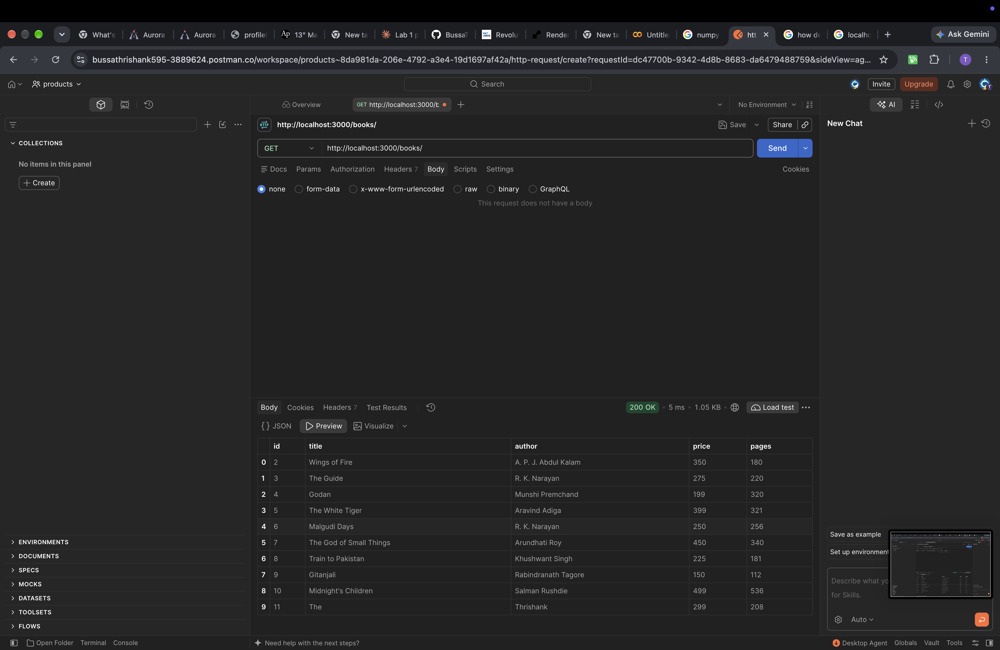
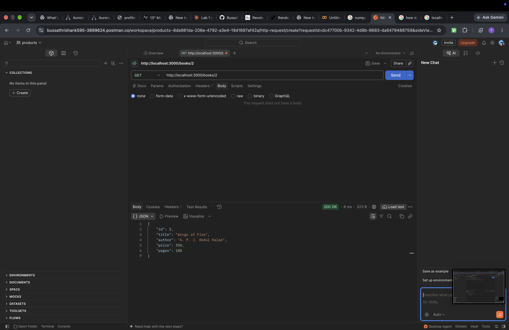
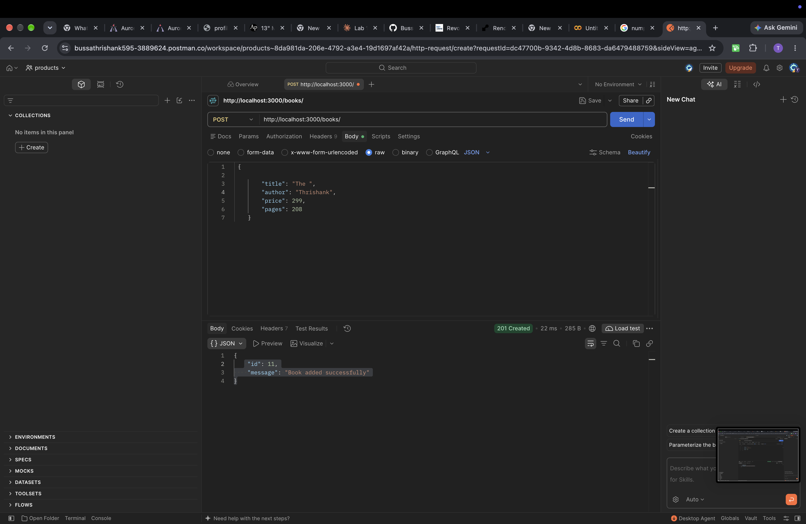
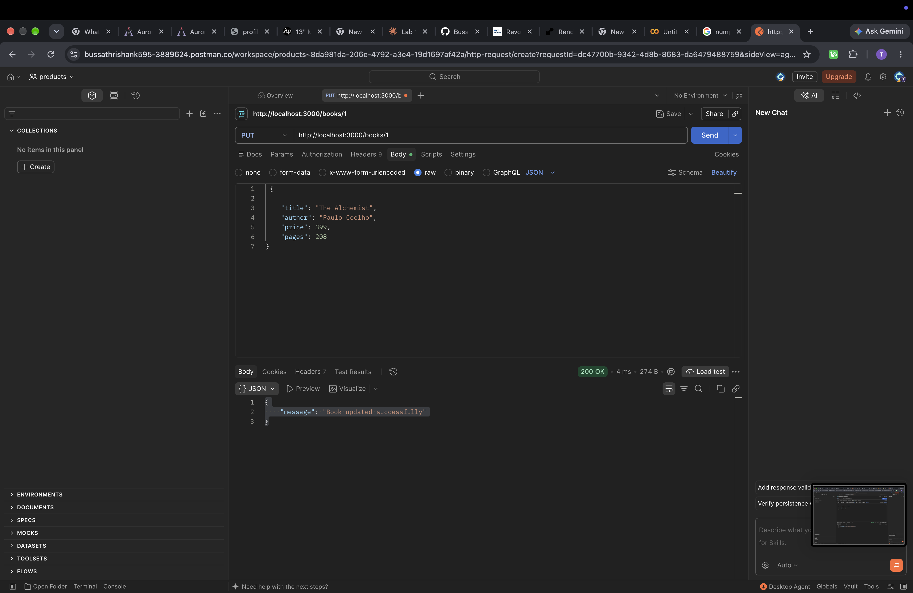
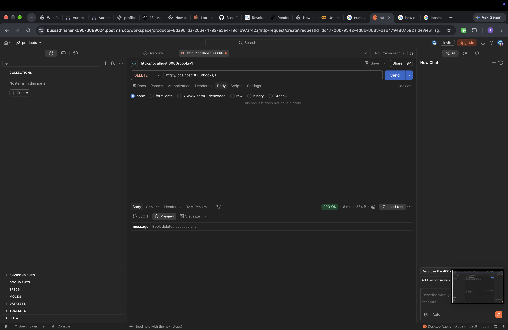
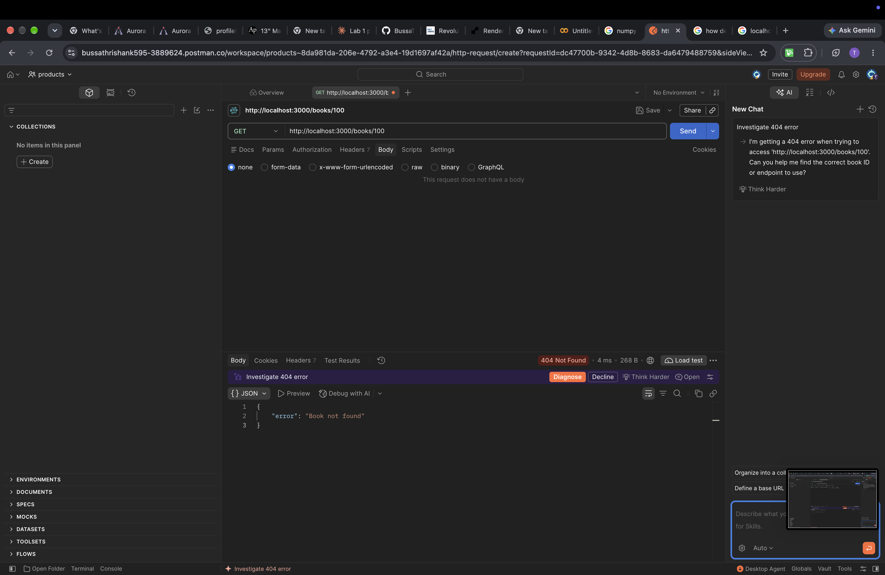
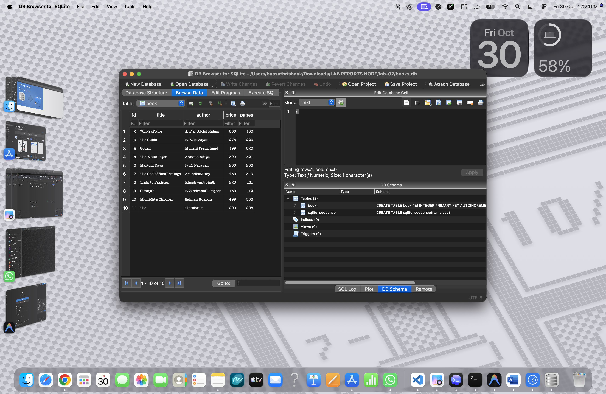

# Lab 2: SQLite database and CRUD routes

**Name:** Thrishank · **Registration number:** 252U1R9022 · **Section:** CSE-GEN-AI-2A-304

**Live link:** `<paste your public URL here after deploying on Render / Railway / NxtWave Cloud IDE>`
(If not deployed: not deployed because ____; Postman screenshots of every endpoint are in `screenshots/`.)

## How to run

```bash
cd lab-02
npm install
npm start          # node server.js
npm run dev        # nodemon server.js (restarts on every change)
```

Environment variables: `PORT` (optional, defaults to 3000). No secrets are needed.

The database file `books.db` is included. To rebuild it from scratch:

```bash
rm books.db
sqlite3 books.db < schema.sql
```

Table: `book(id INTEGER PRIMARY KEY, title TEXT, author TEXT, price INTEGER, pages INTEGER)` with 10 starting rows (inserted by `schema.sql` through the SQLite CLI).

## Endpoints

| Method | Path             | Description                          | Success | Errors   |
| ------ | ---------------- | ------------------------------------ | ------- | -------- |
| GET    | `/books/`        | Get all books                        | 200     | 500      |
| GET    | `/books/:bookId/`| Get one book by id                   | 200     | 404, 500 |
| POST   | `/books/`        | Add a book (JSON body)               | 201     | 400, 500 |
| PUT    | `/books/:bookId/`| Update a book (full JSON body)       | 200     | 400, 404, 500 |
| DELETE | `/books/:bookId/`| Delete a book                        | 200     | 404, 500 |

Request body for POST and PUT:

```json
{ "title": "New Book", "author": "Me", "price": 100, "pages": 50 }
```

## Screenshots









## Notes: viva answers

- **Why await the database call?** Database calls are asynchronous and return promises. Without `await` the code would carry on before the data arrives and the route would send a promise or `undefined` instead of the result.
- **SQL injection and placeholders:** SQL injection is when user input is joined into a query string and changes its meaning (for example `1 OR 1=1`). With `?` placeholders the SQL and the values are sent separately, so input is always treated as data, never as SQL. Every query here with user input uses `?`.
- **PUT vs POST:** POST creates a new resource and the server picks the id. PUT replaces an existing resource at a known URL (`/books/:bookId/`) and repeating it gives the same result.

## Notes: problems faced

- The server starts only inside `initializeDBAndServer()` after the database connection succeeds, so no request can reach a closed database.
- Missing ids return 404 by checking `result.changes` for PUT and DELETE, and an empty row for GET.
