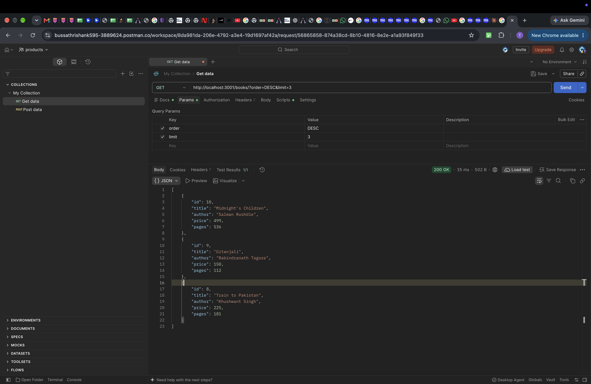
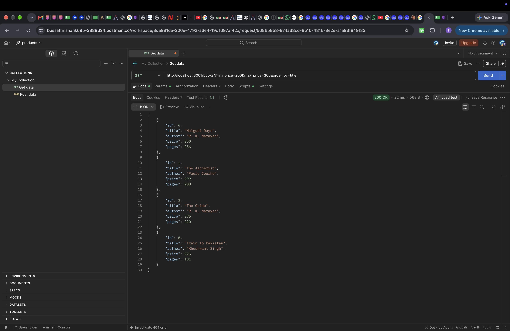
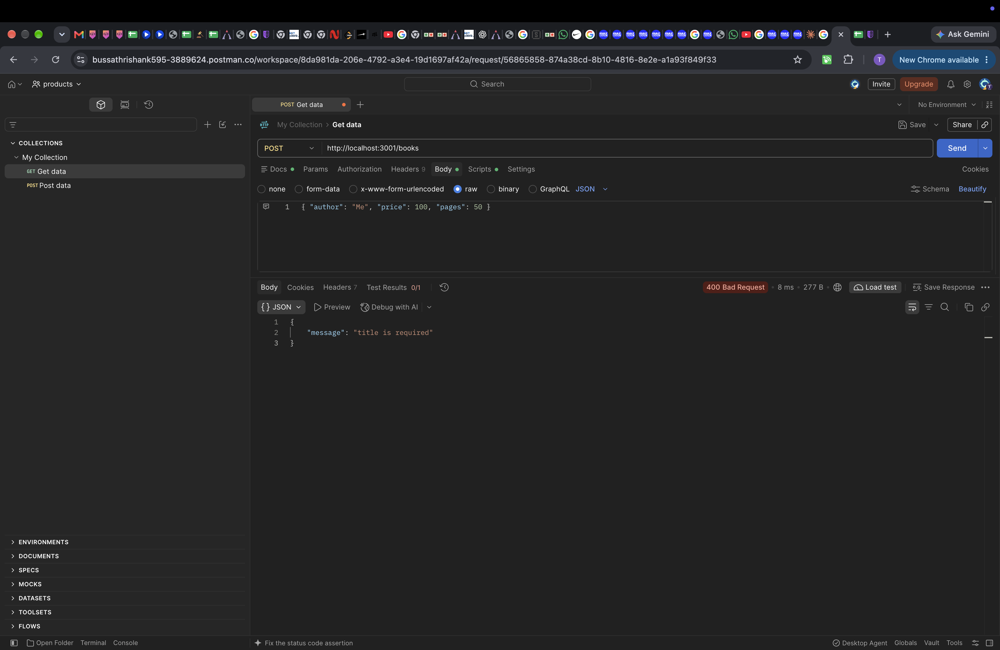
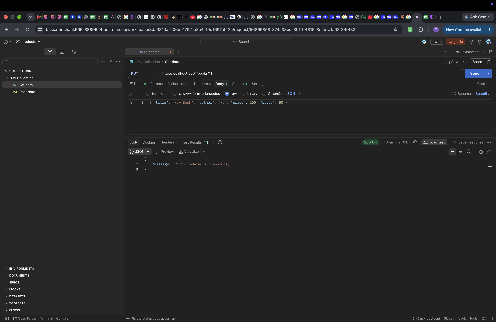
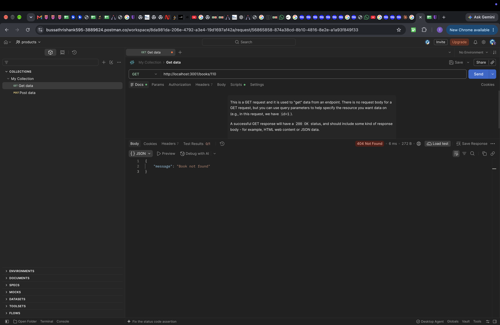

# Lab 3: REST API, query parameters, validation, debugging

**Name:** Thrishank · **Registration number:** 252U1R9022 · **Section:** CSE-GEN-AI-2A-304

**Live link:** `<paste your public URL here after deploying on Render / Railway / NxtWave Cloud IDE>`
(If not deployed: not deployed because ____; Postman screenshots of every endpoint are in `screenshots/`.)

## How to run

```bash
cd lab-03
npm install
npm start          # node server.js
npm run dev        # nodemon server.js (restarts on every change)
```

Environment variables: `PORT` (optional, defaults to 3000). No secrets are needed.

The database file `books.db` is included. To rebuild it: `rm books.db && sqlite3 books.db < schema.sql`.

## Endpoints

| Method | Path              | Description                                   | Success | Errors             |
| ------ | ----------------- | --------------------------------------------- | ------- | ------------------ |
| GET    | `/books/`         | List books with search, filter, sort, paging  | 200     | 400, 500           |
| GET    | `/books/:bookId/` | Get one book                                  | 200     | 400, 404, 500      |
| POST   | `/books/`         | Add a book (validated JSON body)              | 201     | 400, 500           |
| PUT    | `/books/:bookId/` | Update a book (validated JSON body)           | 200     | 400, 404, 500      |
| DELETE | `/books/:bookId/` | Delete a book                                 | 200     | 400, 404, 500      |

### Query parameters for `GET /books/`

| Parameter    | Default | Meaning                                            |
| ------------ | ------- | -------------------------------------------------- |
| `search_q`   | empty   | Partial match on title (`LIKE %text%`)             |
| `order_by`   | `id`    | One of `id`, `title`, `author`, `price`, `pages`   |
| `order`      | `ASC`   | `ASC` or `DESC`                                    |
| `limit`      | `10`    | Number of rows (whole number, at least 1)          |
| `offset`     | `0`     | Rows to skip                                       |
| `min_price`  | none    | Only books with price at least this                |
| `max_price`  | none    | Only books with price at most this                 |

Example: `/books/?search_q=the&order_by=price&order=desc&limit=3&min_price=200`

### Request body for POST and PUT

```json
{ "title": "New Book", "author": "Me", "price": 100, "pages": 50 }
```

`title` and `author` must be non-empty text, `price` must be a number (0 or more), `pages` is optional but must be a positive whole number if given.

### Response format

Success responses return the data or `{ "message": "..." }`. Every error returns `{ "message": "..." }` with the status code: 400 for bad input, 404 for a missing book or route, 500 for server errors.

## Postman tests

`postman_collection.json` and `POSTMAN_TESTS.md` hold 20 tests (8 success, 12 failure) with the expected status for each.

## Screenshots










## Notes: viva answers

- **Query vs path parameter:** a path parameter identifies one specific resource (`/books/5/`); query parameters refine a collection request with optional filters, sorting and paging (`/books/?order=DESC&limit=3`).
- **Stateless:** each request carries everything the server needs; the server keeps no memory of earlier requests from the client, so any request can be handled on its own.
- **Bad input vs missing record:** 400 Bad Request for invalid input (missing title, non-numeric price); 404 Not Found when the id or route does not exist.

## Notes: debugging exercise (problems faced and fixes)

| Error | Cause | Fix |
| ----- | ----- | --- |
| `EADDRINUSE` | Another process already uses the port | Stop the old process (or run on another port with `PORT=3001 npm start`) |
| `Cannot find module` | Wrong import path or package not installed | Correct the relative path (`./`, `../`) or run `npm install` |
| `no such table: books` | Table-name typo (table is `book`) | Use the exact table name in the SQL |
| Route returns `{}` or a promise | Missing `await` on the database call | Add `await` inside an `async` function |

Other notes:
- Column names for `order_by` cannot use `?` placeholders, so they are checked against a fixed list before being placed in the query. All values (search text, prices, limit, offset, ids) use `?` placeholders.
- The 404 route handler and the invalid-JSON handler sit after all routes.
